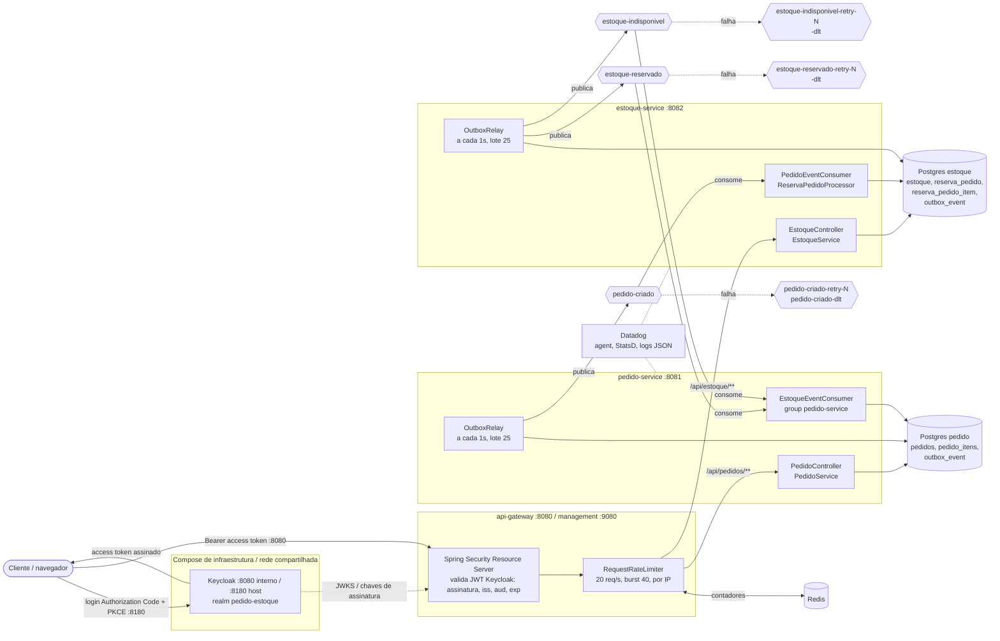
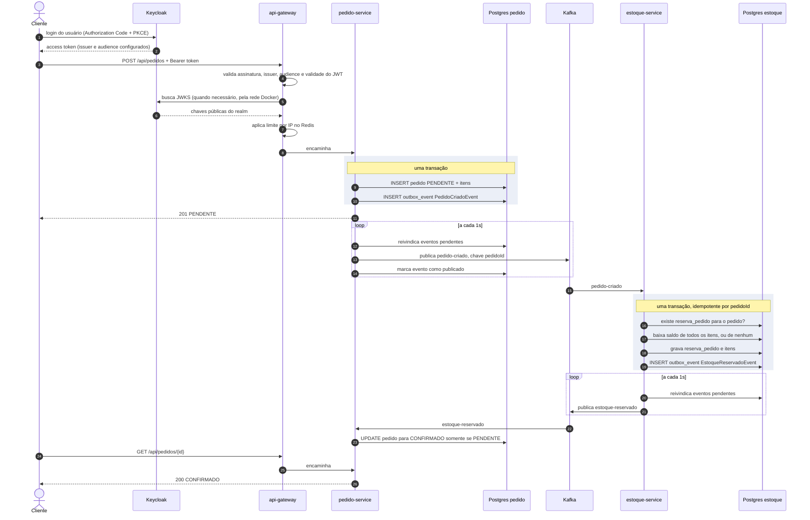
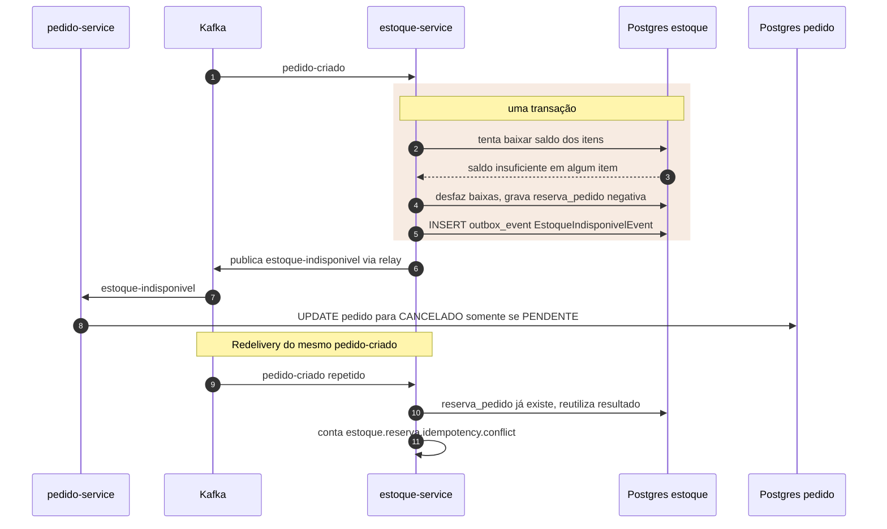
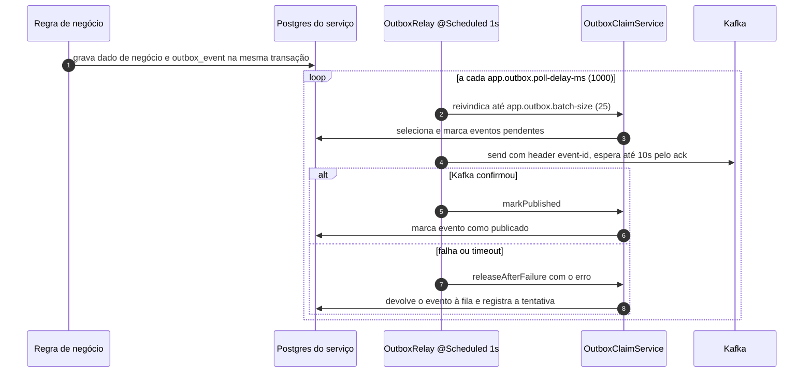
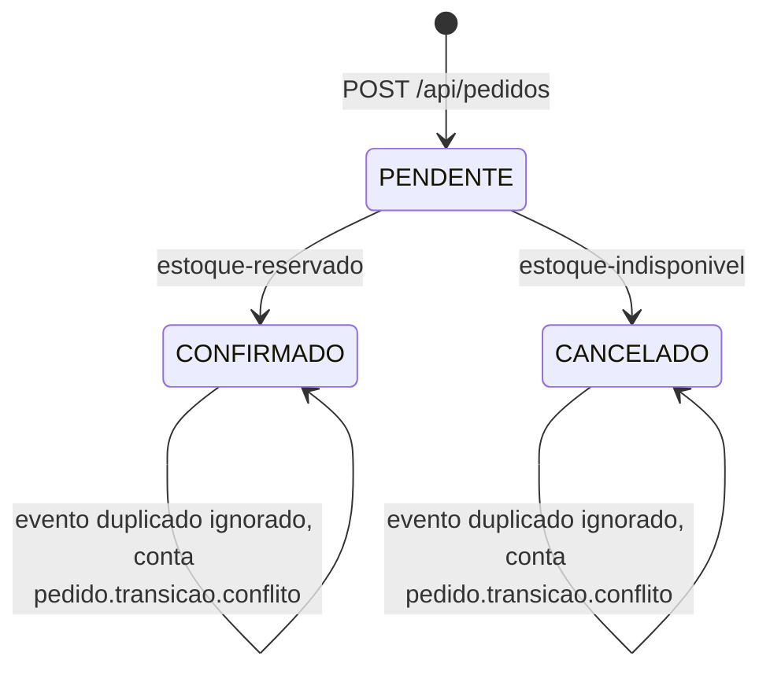

# Arquitetura do sistema Pedido-Estoque

Estado após a change `api-security-keycloak`. Os diagramas são Mermaid e o GitHub os renderiza nesta página. Atualize-os na mesma change que alterar fluxo, tópicos ou componentes.

## 1. Componentes e dados

Cada serviço tem seu próprio Postgres. A única ligação entre pedido e estoque é o Kafka, e todo evento sai por uma tabela outbox gravada na mesma transação do negócio.

_O navegador autentica o usuário no Keycloak (Authorization Code + PKCE) e recebe um access token. O cliente envia o token ao gateway; o gateway valida assinatura usando o JWKS do Keycloak, `iss`, `aud` e validade temporal antes de aplicar rate limit e rotear a chamada. Não há exigência de roles/scopes nesta etapa. Linhas cheias são o caminho normal; linhas tracejadas indicam consulta de chaves ou desvio para retry/DLT. Postgres, Kafka, Redis e Keycloak ficam no Compose de infraestrutura, separado do Compose da aplicação. Apenas gateway (`8080`) e Keycloak (`8180`) são publicados no host; serviços e management permanecem internos._

## 2. Criar pedido com estoque disponível

O cliente recebe 201 assim que o pedido é gravado como PENDENTE. A confirmação chega depois, de forma assíncrona. Nenhuma publicação no Kafka acontece dentro da transação HTTP.

_As duas caixas sombreadas são as fronteiras transacionais. Se o processo cair entre gravar e publicar, o relay publica no próximo ciclo (entrega pelo menos uma vez)._

## 3. Estoque insuficiente

A reserva é tudo ou nada. Se um item não tem saldo, nada é baixado, o resultado negativo é gravado e o pedido é cancelado.

_A reentrega do mesmo evento não baixa saldo de novo: o resultado gravado por `pedidoId` é a fonte da resposta._

## 4. Retry, DLT e mensagem corrompida

Vale para os três consumers. A decisão central é se o erro é transitório (tenta de novo) ou se o registro nunca vai processar (vai direto ao DLT com os bytes originais).

_Um registro que não desserializa nunca chega ao `@DltHandler`, por isso a contagem `kafka.poison.records` existe à parte. Não há ferramenta de replay: o DLT é só inspeção e alerta (backlog 4)._

## 5. Como o outbox publica

O mesmo desenho existe nos dois serviços, cada um com sua própria tabela `outbox_event`.

_Garantia: pelo menos uma vez. Duplicatas são absorvidas no destino (reserva idempotente por pedido, transição só a partir de PENDENTE)._

## 6. Estados do pedido

_Só PENDENTE aceita transição. Se o evento chega antes de o pedido estar visível, o consumer falha e entra no retry (`pedido.evento.pedido_nao_visivel`)._

## Onde evoluir

Ver o backlog em `AGENTS.md` (itens 1 a 6). Lacuna sem item próprio: pedido PENDENTE sem timeout nem compensação quando o estoque nunca responde e o registro fica no DLT.
